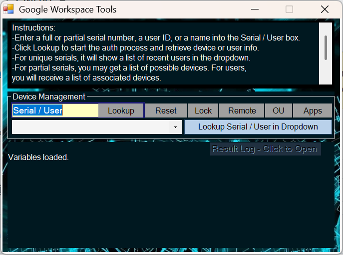

# Google Workspace EndPoint and User Management

A Windows desktop administration utility for Google Workspace administrators, designed to simplify Chromebook management, user/device investigation, and remote support.

The tool brings commonly used Google Workspace administrative operations into a single interface, reducing the need to navigate multiple pages in the Google Admin console.

## Features

### Device Management
- Lock and unlock Chromebooks remotely.
- Powerwash Chromebooks.
- View installed applications on managed devices.
- View device details, including serial number, model, ChromeOS version, last synchronization, and IP addresses.
- Change device organizational units (OUs).

### User and Device Investigation
- Find users associated with a Chromebook.
- Find Chromebooks associated with a particular user.
- View recent users associated with a device.
- Search using device identifiers or user email addresses.
- Retrieve multiple device results for users associated with more than one Chromebook.

### Remote Support
- Request remote access to Chromebooks.
- Initiate remote support workflows directly from the application.

### Organizational Unit Management
- Move users between organizational units.
- Move Chromebooks between organizational units.
- Navigate the complete Google Workspace OU hierarchy through a tree-based selection interface.

## Authentication and Security

The application connects to Google Workspace using OAuth 2.0.

Authentication features include:

- Browser-based Google authentication.
- PKCE authorization flow using SHA-256.
- Randomized OAuth state validation.
- Localhost callback handling.
- Access-token validation and refresh handling.
- Domain-restricted authorization.

The application requires a Google Cloud project with the appropriate APIs enabled and OAuth credentials configured.

See [Workspace API Setup](WORKSPACE-API-SETUP.md) for instructions on creating and configuring the Google Cloud application.

## Requirements

- Windows operating system.
- Google Workspace administrator account with appropriate administrative privileges.
- Google Cloud OAuth application credentials.
- Required Google Workspace APIs enabled.
- Network connectivity to Google authentication and API endpoints.

The permissions granted to the authenticated administrator determine which operations are available.

## Installation

Download the latest release from the repository's **Releases** section.

1. Download and extract the application package.
2. Follow the instructions in [Workspace API Setup](WORKSPACE-API-SETUP.md) to configure your OAuth credentials.
3. Place the configured `workspace.xml` file alongside the application executable.
4. Launch the application.

## Configuration

The application uses a `workspace.xml` configuration file containing:

- Google Workspace domain
- OAuth Client ID
- OAuth Client Secret

Refer to the API setup documentation for configuration details.

## Source Code

The PowerShell source code is provided separately for administrators who want to inspect how the application works or customize it for their environment.

### Support ADEP

If you find ADEP useful, consider supporting its continued development with a donation.

[☕ Support ADEP via PayPal $10](https://paypal.me/thielensys/10)

